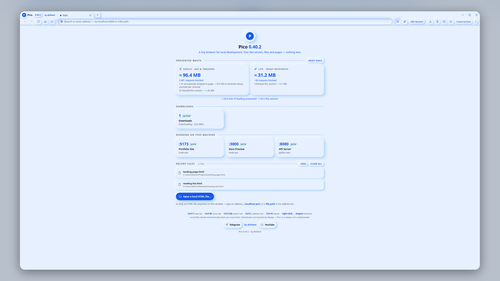
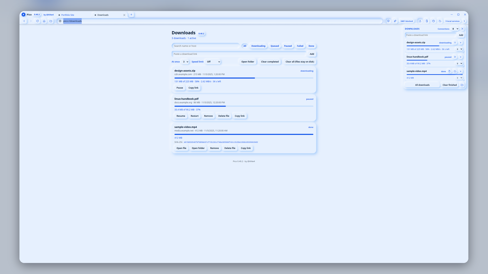

<p align="center">
  
</p>

<h1 align="center">Pico</h1>

<p align="center">
  A tiny browser for Windows that fits in a single file — nothing to install.<br>
  It finds your running local projects on its own, blocks ads, and manages your downloads.<br>
  No accounts, no tracking. Just open it and browse.
</p>

<p align="center">
  <a href="https://github.com/iK4w4/Pico/releases"></a>
  
  
  
  
  <a href="https://github.com/iK4w4/Pico/actions/workflows/ci.yml"></a>
</p>

<p align="center">
  <a href="https://www.youtube.com/@iK4w4"></a>
  <a href="https://t.me/iK4w4"></a>
  <a href="https://t.me/AskKawaBot"></a>
</p>

## Download

Get `Pico.exe` from the [Releases](https://github.com/iK4w4/Pico/releases)
page and run it. It needs the Microsoft Edge WebView2 Runtime, which
ships with Windows 11 and recent Windows 10.

- Size: 1,935,360 bytes
- SHA-256: 20741f2ed130c40cfd2259904a9a0b7df047780a4f309b539993243666a75d22

## Screenshots



*The start page: running dev servers as cards, what the Shield and Lite have saved, and live downloads at a glance.*



*The download manager: every file with its progress, live speed, and controls; finished files carry a SHA-256.*

## Features

| | |
|---|---|
| **Finds your servers** | Dev servers already running on your machine appear as cards on the start page |
| **Live reload** | Local `.html` files are served from a loopback-only server and reload when the file changes |
| **Download manager** | Pico's own engine — multi-connection ranged segments that split and rebalance, pause and resume (across restarts too), 1–5 at a time, optional speed limit |
| **Downloads page & popover** | Toolbar popover with live speed and time left; full page (Ctrl+J) with search, filters, per-file actions and a SHA-256 for every finished file |
| **Refresh link** | A download whose signed link expired re-reads a fresh link from the page it came from, keeping its progress |
| **Bookmarks & history** | Star or Ctrl+D to bookmark; the address bar suggests bookmarks first, then history ranked by visits and recency; Ctrl+H opens the history page |
| **Site icons** | Bookmark cards, recent tiles and history rows show each site's own favicon, cached locally |
| **Movable tabs** | Drag tabs to reorder (or Ctrl+Shift+PageUp / PageDown); a tab's right-click menu can hand its page to a new Pico window |
| **The Shield** | Three-layer ad and tracker blocking on the real EasyList, EasyPrivacy and uBlock lists — downloaded on first run, never bundled; fails open, loopback never blocked |
| **Lite mode** | A page diet for heavy sites: exactly one video per page may play — the one you chose |
| **16 themes** | Palette themes in light and dark that recolor everything live, internal pages included |
| **Own right-click menu** | A small menu in Pico's style for links, images and selections; the browser's built-in menu is off |
| **No extras** | No accounts, no sync, no telemetry, no extensions, no settings page |

## Where your data lives

Nothing is written beside the exe — `Pico.exe` can live anywhere and
be replaced on its own when you update. Everything Pico keeps lives
in `%LOCALAPPDATA%\Pico`: settings, bookmarks and history, the log,
download state, the cached filter lists and the WebView2 profile.
Downloaded files land in your Windows Downloads folder.

The first run of 0.41.0 or later moves an old `data\` folder from
beside the exe into the new home by itself: the copy is verified
before the old folder is removed, and if anything cannot be verified
the old folder is left exactly where it was and Pico runs from the
copies. Files an older Pico put in a `Downloads` folder beside the
exe stay where they are — Pico still finds them for its records.

## Troubleshooting

- **A download failed with 403 / an expired link** — open the
  downloads page and use **Refresh link** on that row.
- **The Shield seems off on first run** — the filter lists download
  once, in the background; `pico.log` (in `%LOCALAPPDATA%\Pico\`)
  says `shield: lists compiled` when they land.
- **A site looks broken** — turn the Shield or Lite off for a moment
  (toolbar toggles); both fail open by design.

## Security

Pico stores no passwords and sends nothing anywhere except the
requests your browsing makes, a Google search when you type
non-URL text into the address bar, and the one-time filter-list
download.
Cookies are scoped per download task and never logged, file names
are made safe, the local server sits behind a host wall, and Pico's
internal pages cannot be opened or driven by web content.
[SECURITY.md](SECURITY.md) describes the design in full, including
the audit passes and the 0.41.0 move of all data into
`%LOCALAPPDATA%\Pico`.

## Build from source

You need Rust and the Windows target tooling (`cargo-xwin` with
LLVM). Then:

```
cargo xwin build --release --target x86_64-pc-windows-msvc
python scripts/check_no_manifest.py target/x86_64-pc-windows-msvc/release/Pico.exe
```

The gate script proves the shipped binary carries **no embedded
manifest** (zero RT_MANIFEST entries), only the icon resource, and
no CRT imports — Pico's hard laws, checked on the final artifact.
The test battery is `scripts/battery.sh` (Rust suites plus a DOM
suite that drives the real pages in jsdom). Filter lists are
downloaded, never bundled; their licenses stay with them
([SOURCES.md](SOURCES.md)).

## Credits

Created by **iK4w4** —
[GitHub](https://github.com/iK4w4) ·
[YouTube](https://www.youtube.com/@iK4w4) ·
Telegram [@AskKawaBot](https://t.me/AskKawaBot)

## License

MIT — see [LICENSE](LICENSE). Copyright (c) 2026 iK4w4.
