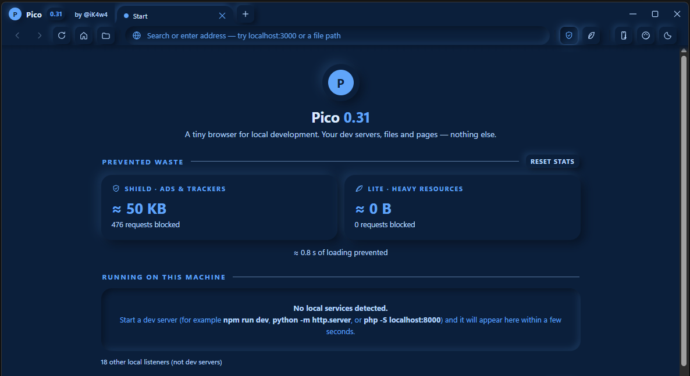

# Pico 0.31

A tiny, portable Windows browser for local development — one
`Pico.exe`, no installer. Pico watches your machine for running
dev servers and puts them on its start page as clickable cards,
serves local HTML files with live reload, and wraps it all in a
soft neumorphic shell with sixteen color themes.

Built with Rust on tao/wry and the Edge WebView2 runtime
(included with Windows 11 / recent Windows 10). No embedded
manifest, static CRT — just run it.

by iK4w4 ([@iK4w4](https://t.me/iK4w4))

## Download

Grab `Pico.exe` from the
[latest release](https://github.com/iK4w4/Pico/releases/latest)
— one file, no installer, just run it. (The source archives
listed under each release are generated by GitHub from this
repository.)

The 0.31.1 file: `Pico.exe`, 1,327,616 bytes, SHA-256
`763e72391a87d13376c00ed8a2bbfea688e788b520a6f2a64bd7c3423b4a87e4`.

> **Scope:** Pico is a young, one-person project built for
> *local development*. It is not a replacement for your main
> browser — keep Edge, Firefox or Chrome for banking, email
> and anything else sensitive.

## Screenshots

*The start page: Shield and Lite keep score of the waste they
prevented (476 requests blocked on the author's machine), and
dev servers appear underneath as cards the moment they start.*

## Features

- **Start page that finds your servers** — running localhost
  services appear as cards (port, title, process); recent local
  files are one click away; local HTML opens by drag-and-drop,
  file picker, or command line, served by a built-in loopback
  static server with live reload.
- **The Shield** — an ad/tracker blocker with network,
  cosmetic, and scriptlet layers and Adblock-Plus rule
  semantics. On first run Pico downloads the EasyList,
  EasyPrivacy and uBlock Origin filter lists from their
  official sources — the same way uBlock Origin does — and
  caches them next to the exe in `data\lists\` (see
  [SOURCES.md](SOURCES.md)). Until the lists land, the Shield
  is idle and Pico browses normally.
- **Lite mode** — blocks heavy resources on public pages while
  the video you actually chose to watch still plays; hover
  previews and every other unsolicited playback stay dead.
- **Savings band** — the start page keeps score, Brave-style:
  requests blocked (exact), estimated bandwidth and time saved
  (≈, calibrated from your own measured traffic), plus the ad
  payload the Shield stripped in-page, counted separately.
- **Sixteen themes** — palettes × dark/light from one
  derivation engine, switchable from the palette panel, with a
  soft accent glow. Forest is the default.
- **Phone Teleport** — a QR card that hands the current page
  to your phone (loopback dev URLs are rewritten to your LAN
  address — only use it on networks you trust: that makes the
  dev server reachable by other devices on the network).
- **Portable by design** — state, log, filter lists and the
  browser profile all live in a `data\` folder beside the exe.
  Delete the folder for a factory reset. Note: whoever copies
  the folder copies the logins inside it — keep it private.

## Non-goals

By design, Pico has no downloads manager (downloads are
denied), no bookmarks or history UI, no extensions, and no
accounts, sync or telemetry. It is a local-development
browser, not a general-purpose one.

## Building

You need a Rust toolchain (https://rustup.rs).

- Test suite (any OS): `cargo test --locked
  --no-default-features` — the verified floor.
- Windows executable: on Windows with the MSVC toolchain,
  `cargo build --release`. Cross-building from Linux uses
  cargo-xwin; the recipe (MSVC target, static CRT, the
  icon-only resource) lives in `.cargo/config.toml`, and
  `scripts/check_no_manifest.py` verifies the shipped exe
  carries no manifest resource. `scripts/battery.sh N` runs
  the full battery (Rust suites + the jsdom DOM suite +
  periodic Windows-target checks) N consecutive times.

## Troubleshooting

`pico.log` sits in the `data` folder next to `Pico.exe` (or
`%APPDATA%\Pico\` if Pico fell back). Useful lines:
`data: portable …` / `data: fallback appdata (…)` show where
your data lives; `shield: lists unavailable (…)` explains a
Shield that has not downloaded its lists yet; `lite chosen:
tab=… host=…` marks the moment a page designated the video
you picked.

## Feedback

- **Bugs & feature requests** — open an
  [issue](https://github.com/iK4w4/Pico/issues); the templates
  will walk you through it.
- **Questions, opinions, show & tell** — the
  [Discussions](https://github.com/iK4w4/Pico/discussions) tab
  is the place.
- Like Pico? A ⭐ star helps other people find it.

## Credits

- Filter lists: [EasyList](https://easylist.to/) and
  [uBlock Origin](https://github.com/gorhill/uBlock) by
  Raymond Hill and contributors — downloaded at runtime,
  never bundled; their licenses stay with them
  ([SOURCES.md](SOURCES.md)).
- Rendering: Microsoft Edge WebView2.
- Find the author on Telegram (https://t.me/iK4w4) and
  YouTube (https://www.youtube.com/@iK4w4). Questions: [@AskKawaBot](https://t.me/AskKawaBot) on Telegram.

## License

MIT — see [LICENSE](LICENSE). Copyright (c) 2026
iK4w4.
