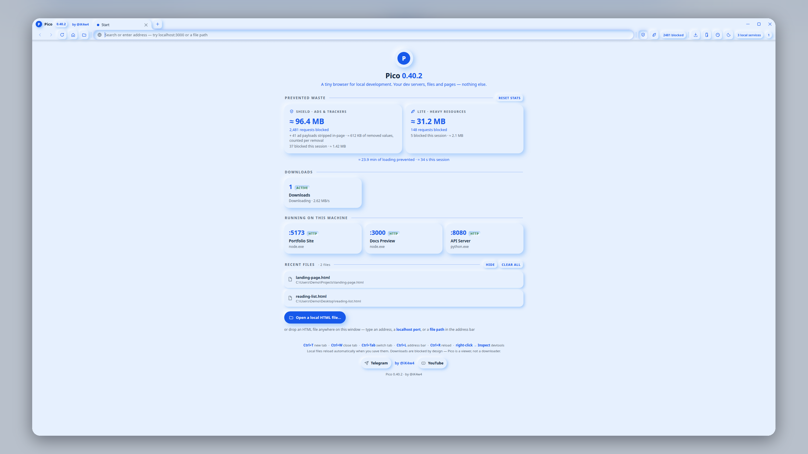
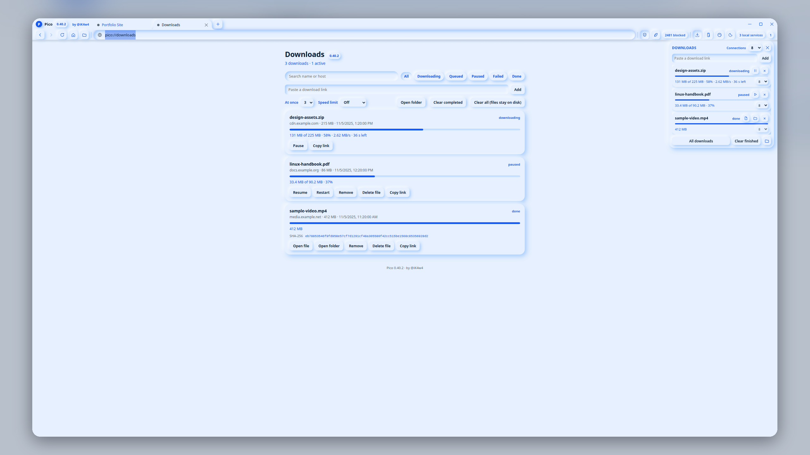

# Pico - a Tiny Browser

[](https://www.youtube.com/@iK4w4)
[](https://t.me/iK4w4)
[](https://t.me/AskKawaBot)

A tiny, neumorphic Windows browser for local
development — and, since 0.32, a download manager.
One portable `Pico.exe`: no installer, no embedded
manifest, static CRT. Pico auto-detects the dev
servers already running on your machine, serves
local files with live reload, and stays out of the
way the rest of the time.

## Download

Grab `Pico.exe` from the
[Releases](https://github.com/iK4w4/Pico/releases)
page and run it. It needs the Microsoft Edge
WebView2 Runtime, which ships with Windows 11 and
recent Windows 10.

- Size: 1,639,936 bytes
- SHA-256: 805d9c4e2a87792d11fd99662f3d0c640bb2dc1af5ae3c33bd876764d95342e4

Everything Pico keeps — settings, the log, the
cached filter lists and the WebView2 profile —
lives in a `data\` folder beside the exe, so Pico
is fully portable: copy the folder anywhere and it
works the same. Download state lives there too
(`data\downloads\`); finished files land in a
`Downloads` folder beside the exe when it is
writable (otherwise your Windows Downloads
folder).

## Screenshots



*The start page: running dev servers as cards, what the Shield and Lite have saved, and live downloads at a glance.*



*The download manager: every file with its progress, live speed, and controls; finished files carry a SHA-256.*

## What's inside

- **Tabs and navigation** — the usual browser
  basics, nothing else: no bookmarks, no history
  page, no accounts, no sync, no telemetry, no
  extensions, no settings page.
- **A real download manager** — downloads are
  handled by Pico itself, not handed to the
  browser engine: multi-connection HTTP(S)
  downloads with ranged segments that split and
  rebalance as they go, pause and resume (across
  restarts, too), 1–5 downloads at a time with a
  per-download connection count and an optional
  overall speed limit. Clicks that start a
  download confirm with a toast; failures say why
  and retry on their own with backoff.
- **A downloads popover and page** — the toolbar
  button opens a compact card: every active
  download with its progress bar, live speed and
  time left, plus pause / resume / cancel. The
  full page (`pico://downloads`, or Ctrl+J) holds
  the whole history with search and status
  filters, per-file actions, a SHA-256 for every
  finished file, and **Refresh link** for the
  download whose signed link has expired — Pico
  re-reads a fresh link from the page you got it
  from instead of starting over.
- **Pico's own right-click menu** — links, images
  and selections get a small menu in Pico's style
  (the browser's built-in menu is off): open in a
  new tab, copy link / image / selection, save
  image, paste, select all.
- **The Shield** — a three-layer ad and tracker
  blocker (network rules, cosmetic hiding,
  scriptlets) running the real EasyList,
  EasyPrivacy and uBlock filter lists with
  Adblock-Plus semantics. The lists are **not
  bundled**: on first run Pico downloads them from
  their canonical sources (see [SOURCES.md](SOURCES.md))
  and caches them in `data\lists\`. A main-frame
  page is never blocked, loopback is never
  blocked, and the Shield fails open — if the
  lists are missing or the engine is unsure, the
  page loads.
- **Lite mode** — an aggressive page diet for
  heavy sites, with chosen-video semantics:
  exactly one video per page may play (the one
  you chose); previews and background videos stay
  dead.
- **A start page that finds your servers** —
  running localhost services appear as cards,
  with a savings band showing what the Shield and
  Lite have blocked and saved (bandwidth and time
  figures are estimates, marked as estimates).
- **Sixteen themes** — palette themes in light
  and dark that recolor everything live,
  including the start page and the downloads page
  while they are open.
- **Local files done right** — drag an `.html`
  file in (or open one) and it is served from a
  loopback-only local server with live reload
  when the file changes.

## Troubleshooting

- **A download failed with 403 / an expired
  link** — open the downloads page and use
  **Refresh link** on that row; Pico revisits the
  page the download came from and picks up the
  fresh link, keeping your progress where the
  server allows it.
- **The Shield seems off on first run** — the
  filter lists download once, in the background;
  on a slow connection the first run may browse
  unfiltered for a minute. `pico.log` (in `data\`)
  says `shield: lists compiled` when they land.
- **A site looks broken** — turn the Shield or
  Lite off for a moment (toolbar toggles); both
  fail open by design, and Pico keeps no other
  content policies.

## Security

[SECURITY.md](SECURITY.md) describes the design:
how downloads are captured and routed, how
cookies are scoped per task and never logged,
how file names are made safe, the host wall on
the local server, what the log redacts, and the
0.40.1 audit pass and the 0.40.2 external-review
fixes. In short: Pico stores no
passwords, sends nothing anywhere except the
requests your browsing makes and the one-time
filter-list download, and its internal pages
cannot be opened or driven by web content.

## Building from source

You need Rust and the Windows target tooling
(`cargo-xwin` with LLVM). Then:

```
cargo xwin build --release --target x86_64-pc-windows-msvc
python scripts/check_no_manifest.py target/x86_64-pc-windows-msvc/release/Pico.exe
```

The gate script proves the shipped binary carries
**no embedded manifest** (zero RT_MANIFEST
entries), only the icon resource, and no CRT
imports — Pico's hard laws, checked on the final
artifact. The test battery is `scripts/battery.sh`
(Rust suites plus a DOM suite that drives the real
pages in jsdom).

## Notes

- Language: Rust only (tao / wry / WebView2).
- Filter lists are downloaded, never bundled;
  their licenses stay with them
  ([SOURCES.md](SOURCES.md)).
- Rendering: Microsoft Edge WebView2.
- Find the author on Telegram (https://t.me/iK4w4) and
  YouTube (https://www.youtube.com/@iK4w4).

## License

MIT — see [LICENSE](LICENSE). Copyright (c) 2026
iK4w4.
